<p align="center">
  
</p>

<h1 align="center">Distract Blocker</h1>

<p align="center">
  <b>Block the sites you keep opening.</b><br>
  A quiet Chrome extension with a side panel, a keyboard shortcut and a guardian mascot who would rather you did not.
</p>

<p align="center">
  <a href="https://distract-blocker.suenot.com">Website</a> ·
  <a href="#install">Install</a> ·
  <a href="#how-it-works">How it works</a> ·
  <a href="PRIVACY.md">Privacy</a> ·
  <a href="LICENSE">MIT</a>
</p>

<p align="center">
  
</p>

## How it works

1. Click the toolbar icon. A side panel opens next to your tabs.
2. Add the sites you want gone: one by one, or paste a whole list.
3. Flip the switch. Any visit to a listed site lands on a friendly "Not now" page instead of the site.
4. Need the site for a minute? Turn blocking off from the panel, or press your custom shortcut.

Blocking uses Chrome's native `declarativeNetRequest` rules. There are no content scripts and no remote code.

## Features

- **Side panel UI** (Manifest V3): toggle, list, textarea, language switcher.
- **Custom keyboard shortcut** flips blocking without opening the panel.
- **Two list editors**: list view with add and remove, or a textarea for pasting a full list. The mode you pick is remembered.
- **Schedule**: always, only during chosen hours, or only outside chosen hours. Day-of-week chips and time pickers, overnight ranges work.
- **Protected mode**: lock the panel with a PIN or password. Stored only as a salted hash, locally.
- **21 languages** with RTL support: English, Русский, 中文, 日本語, 한국어, Español, Português, हिन्दी, العربية, Français, Deutsch, Italiano, Nederlands, Türkçe, Қазақша, Oʻzbek, Кыргызча, Bahasa Indonesia, Tiếng Việt, ไทย, Bahasa Melayu.
- **Friendly blocked page**: a polite "not now" with the mascot instead of a Chrome error.
- **No telemetry, no account.**

## Install

From source, until the store listing is live:

1. Open `chrome://extensions/` and turn on **Developer mode**.
2. Click **Load unpacked** and select the repository root.

## Repo layout

```
.
├── manifest.json            Manifest V3
├── background.js            service worker (rules, tab reload, commands)
├── sidepanel.{html,css,js}  side panel UI
├── blocked.{html,css,js}    page shown for blocked navigations
├── lock.js                  protected mode (PIN or password)
├── mascot.js                guardian mascot SVG
├── i18n.js                  runtime locale loader (overrides chrome.i18n)
├── _locales/<lang>/         translations
├── icons/                   extension icons
├── docs/                    hero.svg used in this README
├── chrome-store/            store listing texts and screenshots
├── video/                   Remotion promo video
└── landing/                 Astro + Tailwind marketing site
```

## Landing site

```bash
cd landing
npm install
npm run dev      # local dev server
npm run build    # static build to dist/
```

Live at https://distract-blocker.suenot.com.

## License

MIT
